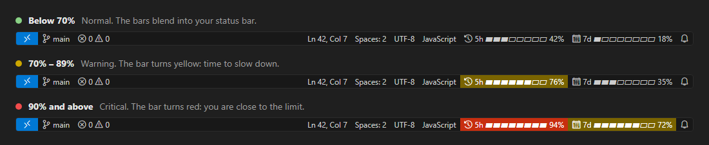

# Claude Usage Bar

See how much of your Claude Code 5-hour and 7-day limits you've used in the VS Code status bar. Hover over either bar for reset times, or click it to see how your usage pace compares with the time left.

> Unofficial community project. It isn't made by or affiliated with Anthropic.



**[⬇ Download claude-usage-bar.vsix](https://github.com/ShahriarRashid67/claude-usage-bar/releases/latest/download/claude-usage-bar.vsix)** · [All releases](https://github.com/ShahriarRashid67/claude-usage-bar/releases)

## Install

You need:

- VS Code 1.82 or newer. Cursor, Windsurf, and VSCodium work too.
- [Claude Code](https://code.claude.com/docs/en/setup), signed in with a subscription that reports usage limits.
- [Node.js](https://nodejs.org/en/download) 16 or newer. The recommended Claude Code installer doesn't need Node.js, so you may not have it. Run `node --version` in a terminal to check. **Connect** also checks and tells you if it's missing.

### 1. Install the extension

**Option A: drag and drop**

1. [Download claude-usage-bar.vsix](https://github.com/ShahriarRashid67/claude-usage-bar/releases/latest/download/claude-usage-bar.vsix).
2. In VS Code, open **Extensions** (`Ctrl+Shift+X`).
3. Drag the downloaded file onto the Extensions view. You can also choose **⋯ → Install from VSIX…** and select the file.

**Option B: one terminal command**

Windows (PowerShell):

```powershell
iwr https://github.com/ShahriarRashid67/claude-usage-bar/releases/latest/download/claude-usage-bar.vsix -UseBasicParsing -OutFile "$env:TEMP\claude-usage-bar.vsix"; code --install-extension "$env:TEMP\claude-usage-bar.vsix"
```

macOS or Linux:

```sh
curl -fsSL -o /tmp/claude-usage-bar.vsix https://github.com/ShahriarRashid67/claude-usage-bar/releases/latest/download/claude-usage-bar.vsix && code --install-extension /tmp/claude-usage-bar.vsix
```

If you use Cursor, replace `code` with `cursor`. If you use Windsurf, replace it with `windsurf`. On macOS, if `code` isn't found, open the Command Palette in VS Code and run **Shell Command: Install 'code' command in PATH**, or use Option A.

### 2. Click **Connect**

Click **Connect** when VS Code asks. The extension checks for Node.js and sets up the bundled helper for you. If you dismissed the message, click **Connect Claude usage** in the status bar or run **Claude Usage Bar: Connect Claude Code** from the Command Palette (`Ctrl+Shift+P`).

If you already have a custom Claude Code status line, the extension asks before replacing it. It keeps a copy, and **Disconnect** puts it back.

### 3. Use Claude Code

Send a message in a Claude Code terminal session. The bars fill in when Claude Code reports your usage.

## Reading the bars

- **5h** is your short-term usage window. **7d** is your weekly window. The percentages show how much of each limit you've used.
- By default, a bar turns yellow at **70%** and red at **90%**. Search VS Code settings for **Claude Usage Bar** to change the thresholds or how the bars look.
- **Ahead of pace** means that at your current rate, you'd reach the limit before the window resets. The estimate changes as your usage changes.

## Troubleshooting

| What you see | What to do |
| --- | --- |
| **Connect Claude usage** in the status bar | Click it to finish setup. |
| "Claude Usage Bar needs Node.js" | [Install Node.js](https://nodejs.org/en/download), restart VS Code, then click **Connect** again. If `node --version` already works in the terminal you use for Claude Code, choose **Connect Anyway**. |
| Both bars show `--` | Send a message in a **new** Claude Code terminal session. If they still show `--`, run `node --version` in that terminal. If it fails, [install Node.js](https://nodejs.org/en/download). |
| One bar shows `--` | Claude Code reports each window on its own schedule. The missing bar fills in when Claude Code sends that number. |
| The numbers look old | Send a message in Claude Code. The bars update only when Claude Code reports new usage. |
| "Can't update Claude Code's settings.json" | Read the reason in the message. If the file contains invalid JSON, click **Open settings.json**, fix it, then click **Connect** again. |
| "settings.json is a link" | A dotfiles tool or similar made your settings file a link, and Claude Usage Bar only edits regular files. Replace the link with a regular copy of the file, then click **Connect**. |
| Disconnect says the saved copy of your status line is missing | Choose **Remove Anyway**. If you had your own status line before, set it up again in Claude Code. |

The extension uses Claude Code's [documented status-line usage fields](https://code.claude.com/docs/en/statusline#rate-limit-usage). Claude Code sends them after a response on eligible plans. Sessions that don't run the status line, such as chat-panel-only use, don't update the bars.

## What "Connect" changes

Connecting copies the bundled helper to `~/.claude-usage-bar/statusline.cjs` and sets `statusLine` in Claude Code's user settings to run it. If you approve replacing an existing status line, the extension saves that entry in its local folder so **Disconnect Claude Code** can restore it.

The helper also shows `5h 42%  |  7d 18%` in Claude Code's own status line.

## Privacy

The helper saves only usage percentages, reset times, and the last update time in `~/.claude-usage-bar/usage.json`. The extension reads that file and reads Claude Code's user settings locally to manage the status-line entry. It preserves the other settings and doesn't access Claude's login token store or send data over the network.

If you replace a custom status line, its original command is kept in a private local file so it can be restored. Any secret written directly in that command is part of the saved entry.

## Update or uninstall

- **Update** by repeating step 1. The download link always gets the newest version, and your settings and connection are kept. Versions installed from a VSIX don't update automatically. To get notified about new versions, choose **Watch → Custom → Releases** on the GitHub repository.
- **Disconnect** by running **Claude Usage Bar: Disconnect Claude Code** from the Command Palette. This restores the previous custom status line if you had one.
- **Uninstall** by disconnecting first, then removing the extension in VS Code. The uninstall hook also disconnects. You can delete `~/.claude-usage-bar` once Claude Code is disconnected.
- **Using more than one editor?** VS Code, Cursor, and Windsurf share one connection to Claude Code. Uninstalling from one disconnects all of them, so click **Connect** in the others afterwards.

If you set up an earlier version by hand with `~/claude-usage-bar-statusline.cjs`, it still works. Click **Connect** once to switch to the self-updating helper, and then you can delete the old file.

## Build from source

With Node.js 22 or newer, open a terminal in the repository folder and run:

```sh
npm ci --ignore-scripts
npm exec -- vsce package --no-dependencies
```

Then install the generated VSIX. Pushing a tag that matches the version in `package.json` triggers the GitHub release workflow. For this version, use `v1.2.0`.

MIT licensed.
